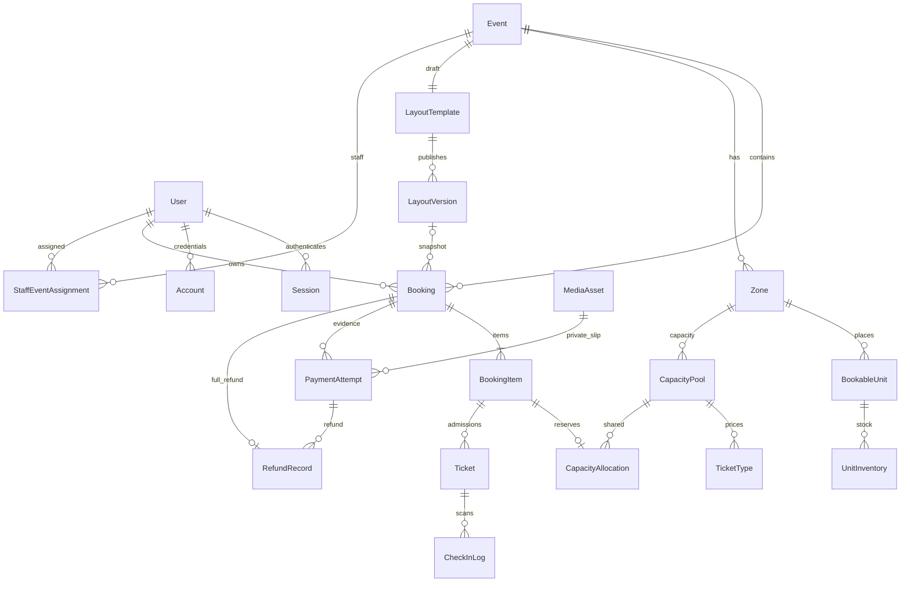

# OneVentOne — Data dictionary

ฐานข้อมูล MongoDB replica set ผ่าน Prisma 6.19.3 ทุก primary key เป็น String/ObjectId (`@map("_id")`); relation IDs ใช้ ObjectId ตรงกัน ใช้ NoAction สำหรับ referential actions เพื่อไม่ cascade ลบข้อมูลประวัติ งานลบ/ยกเลิกต้องผ่าน service validation

| Model                | ความหมายและ field หลัก                                                                                                                                                                                           | Unique / index ที่สำคัญ                                               |
| -------------------- | ---------------------------------------------------------------------------------------------------------------------------------------------------------------------------------------------------------------- | --------------------------------------------------------------------- |
| BusinessProfile      | ธุรกิจเดียว: key,displayName,logo,theme,contact,paymentInstructions,bookingPolicy,holdMinutes,reviewHours,correctionHours,version                                                                                | key=primary                                                           |
| User                 | Better Auth user: name,email,emailVerified,image,roles[],timestamps                                                                                                                                              | email                                                                 |
| Session              | expiresAt,token,userId,ipAddress,userAgent                                                                                                                                                                       | token; userId                                                         |
| Account              | providerId/accountId,userId,password hash,provider token fields                                                                                                                                                  | providerId+accountId; userId                                          |
| Verification         | identifier,value,expiresAt                                                                                                                                                                                       | identifier                                                            |
| RateLimit            | Better Auth persistent key,count,lastRequest (millisecond Float)                                                                                                                                                 | key                                                                   |
| ApiRateLimit         | API operation key,count,expiresAt                                                                                                                                                                                | key; expiresAt                                                        |
| Event                | slug,title,description,artists[],venue,posterUrl,startsAt,endsAt,saleStartsAt,saleEndsAt,status,publishedLayoutVersionId,version,cancellationReason/cancellationProcessedAt                                      | slug; status+startsAt                                                 |
| StaffEventAssignment | userId,eventId สำหรับ check-in                                                                                                                                                                                   | userId+eventId; eventId                                               |
| LayoutTemplate       | draft ต่อ Event: name,width,height,geometry,revision                                                                                                                                                             | eventId                                                               |
| LayoutVersion        | immutable geometry,width,height,version,eventId,templateId,publishedById,publishedAt                                                                                                                             | eventId+version                                                       |
| Zone                 | eventId,code,name,sellingMode,capacity,color                                                                                                                                                                     | eventId+code                                                          |
| BookableUnit         | eventId,zoneId,code,name,sellingMode,parentTableId,admissionCount,priceSatang,active,metadata                                                                                                                    | eventId+code; zoneId                                                  |
| UnitInventory        | eventId,unitId,status,holdBookingId,holdExpiresAt,version                                                                                                                                                        | eventId+unitId; holdBookingId; eventId+status                         |
| CapacityPool         | eventId,zoneId,code,capacity,available,held,reviewReserved,sold,blocked,version                                                                                                                                  | eventId+code; zoneId                                                  |
| TicketType           | eventId,zoneId,poolId,code,name,priceSatang,saleStartsAt,saleEndsAt,active                                                                                                                                       | eventId+code; poolId                                                  |
| Booking              | bookingNumber,userId,eventId,status,totalSatang,totalAdmissions,holdExpiresAt,reviewDueAt,correctionDueAt,layoutVersionId,snapshot,version,reason,verifiedPaymentId,verifiedAmountSatang,confirmedAt,cancelledAt | bookingNumber; userId+createdAt; eventId+status; status+holdExpiresAt |
| BookingItem          | bookingId,sellingMode,unitId/ticketTypeId/poolId,quantity,admissionCount,unitPriceSatang,subtotalSatang,snapshot                                                                                                 | bookingId; unitId (ไม่ unique)                                        |
| CapacityAllocation   | bookingItemId,poolId,quantity,status,version                                                                                                                                                                     | bookingItemId; poolId+status                                          |
| PaymentAttempt       | bookingId,assetId,declaredAmountSatang,transferTime,submittedAt,status,reviewerId,reviewedAt,reviewReason,receivedAmountSatang,duplicateEvidenceWarning                                                          | bookingId+submittedAt; status+submittedAt                             |
| RefundRecord         | bookingId,paymentId,amountSatang,reason,status,operatorId,proofAssetId,completedAt                                                                                                                               | bookingId (เต็มจำนวนครั้งเดียว); status+createdAt                     |
| Ticket               | bookingId,bookingItemId,eventId,ownerId,admissionSequence,tokenHash,encryptedToken,status,usedAt,usedById,revokedAt                                                                                              | tokenHash; bookingItemId+admissionSequence; bookingId; eventId+status |
| CheckInLog           | ticketId?,eventId,actorId,result,createdAt                                                                                                                                                                       | eventId+createdAt                                                     |
| MediaAsset           | storageKey,mime,bytes,ownerId,bookingId?,visibility,uploadStatus,contentHash                                                                                                                                     | storageKey; ownerId+createdAt; contentHash                            |
| AuditLog             | actorId?,action,entity,entityId,reason,changes,createdAt                                                                                                                                                         | entity+entityId+createdAt; createdAt                                  |
| IdempotencyRecord    | actorId,operation,key,requestHash,state,response,statusCode,timestamps                                                                                                                                           | actorId+operation+key                                                 |

## ความสัมพันธ์

## JSON และข้อจำกัด

- `geometry = {objects:[...]}` แต่ละ object มี stable id,type,shape,code,name,x,y,width,height,rotation และ unitId/zoneId ตามประเภท พิกัด world แยกจาก viewport; ราคาหรือ stock ไม่อยู่ใน geometry
- theme/contact/paymentInstructions/bookingPolicy เก็บข้อมูลแสดงผล/นโยบาย `holdMinutes`, `reviewHours`, `correctionHours` เป็น scalar สำหรับบริการและ sync กับ policy ผ่าน service
- snapshots เก็บค่าขณะจอง ไม่ชี้ไปใช้ชื่อ/ราคา/เงื่อนไขล่าสุดเป็นประวัติ
- Prisma optional field ใน MongoDB อาจเป็น null หรือ missing; เงื่อนไขสำคัญใช้ status/owner/version ไม่อาศัย null อย่างเดียว
- ไม่มี optional unique reference ที่ทุกแถว null จนชนกัน `Booking.verifiedPaymentId` เป็น scalar pointer ที่บริการตั้งใน transaction ไม่ unique และไม่ได้ใช้เป็นรายงานผลรวมหลายรายการ
- Prisma ไม่ enforce check constraints เช่น counters sum หรือ cross-document event equality จึงตรวจใน service ภายใน transaction; unique indexes เป็นตัวคุมความซ้ำใน DB
- Idempotency response เป็น JSON ที่ serialize แล้ว ไม่มี token/session/รหัสผ่าน; AuditLog ไม่บันทึก raw credential
- ไม่มี SQL migration/partial custom index/TTL ใน schema นี้

## Seed

`npm run db:seed` สร้าง BusinessProfile มงคลบาร์ และ Event `mongkol-live-session`: 8 โต๊ะ ×4 สิทธิ์, 12 ที่นั่ง และ GA 80 สิทธิ์ร่วมกันระหว่าง Early Bird/Regular ไม่มีบัญชี admin หรือรหัสผ่านตายตัว ไม่มีเลขบัญชีรับเงินจริง

ใช้ upsert แบบ update ว่าง; หาก Event มี published layout แล้ว seed จะเก็บข้อมูลเดิมทั้งหมด ไม่คืน stock ไม่เปลี่ยนราคา ไม่เขียนทับ setting/ผัง วันจัดงานถูกสร้างเป็น 30 วันหลัง seed ครั้งแรก และไม่เลื่อนในการ rerun
